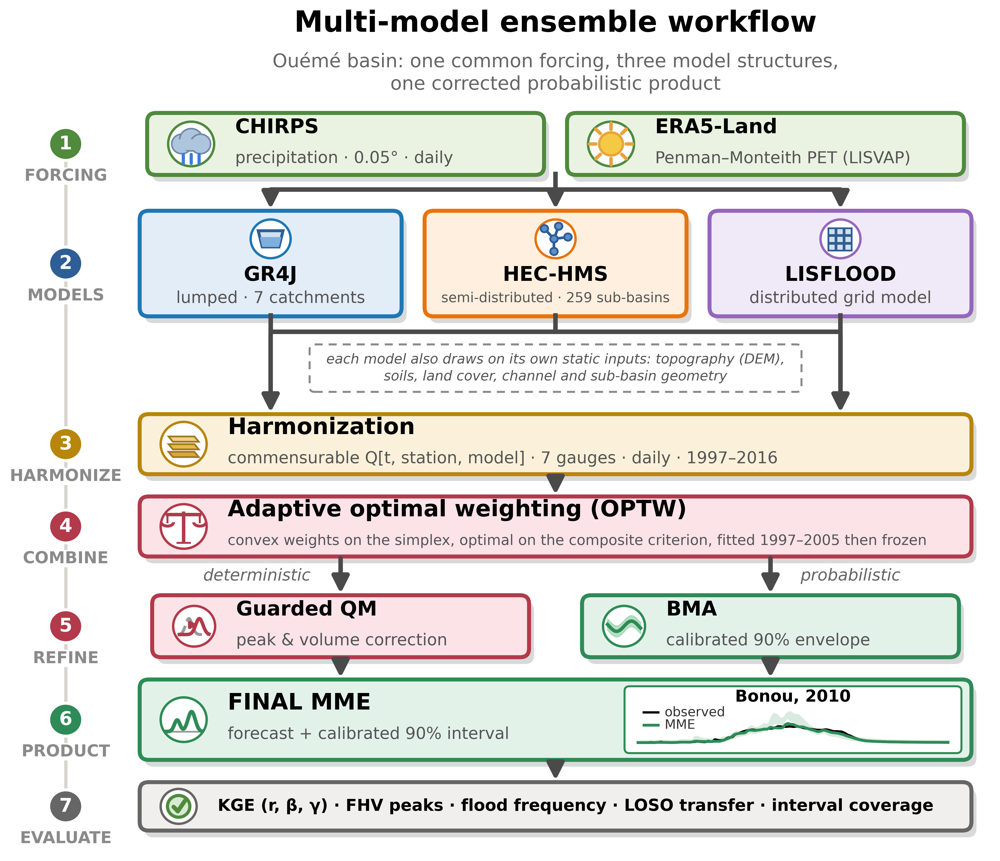

# Constrained multi-model ensemble for streamflow and flood-peak simulation in the Ouémé River Basin

Code, derived data and results accompanying the manuscript:

> Djangni, O., Bossa, Y. A., and Hounkpè, J.: **Constrained multi-model ensemble for streamflow and flood-peak simulation in a data-scarce West African basin, Benin**, submitted to *Hydrology
> and Earth System Sciences*, 2026.

## Overview

The Ouémé River Basin drains about 48,000 km² at Bonou, in Benin, into one
sharply seasonal flood each year, and is gauged by seven nested stations whose
records are short and interrupted by long gaps. Three structurally different
rainfall-runoff models are combined: the lumped GR4J with explicit reach and
confluence routing, the semi-distributed HEC-HMS over 259 sub-basins, and the
distributed LISFLOOD. All three are driven by the same 0.05° CHIRPS rainfall
and the same Penman-Monteith evaporative demand, so that what separates them is
structure and not input.

<p align="center">
  
</p>

### Workflow

- **Benchmark.** Thirty-two combination configurations from twelve families,
  all under one protocol: fitted on 1997-2005, frozen, and scored once on the
  independent 2006-2016 period. Nothing is fitted on the test years, including
  the dynamic schemes, whose weights are frozen at the end of calibration.
- **Weights.** Optimized convex weights on the simplex at each gauge, under the
  composite criterion S = ½ KGE + ½ NSE. A parsimony rule then sets to zero any
  residual share below 0.10 and re-optimizes the rest, a share that small not
  being estimable on nine years of daily record.
- **Correction.** A distributional correction admitted only under a guard, and
  only where the three members share a one-sided high-flow bias. At Ahlan the
  volume removed is routed to the outlet through a transfer function, and the
  propagated series then receives a smoothed quantile mapping at Bonou.
- **Evaluation.** Paired year-block bootstrap on both efficiencies, weights
  fitted on six gauges and applied to the seventh, the split-sample run
  backwards, and a generalized extreme-value fit of the annual maxima.

## Repository structure

```
.
├── data/
│   ├── member_simulations_daily.csv   the three members, daily, seven gauges, 1997-2016
│   └── gauge_network.csv              the gauge network and its cumulative drained areas
├── notebooks/                         the workflow, in four steps
│   ├── 01_method_benchmark.ipynb
│   ├── 02_ensemble_construction.ipynb
│   ├── 03_evaluation.ipynb
│   └── 04_figures.ipynb
├── src/
│   ├── mme_lib.py                     metrics, convex weighting, quantile mapping
│   ├── plot_style.py                  figure styling, applied at save time
│   ├── chart_style.py                 bar and colour conventions
│   ├── benchmark_methods.py           the thirty-two configurations
│   ├── fit_ensemble.py                weights, correction, delivered product
│   ├── weighting_schemes.py           the four weighting schemes compared
│   ├── significance.py                paired year-block bootstrap
│   ├── transferability_loso.py        weights fitted elsewhere, applied here
│   ├── reversed_split.py              calibration and test windows swapped
│   ├── flood_frequency.py             generalized extreme-value fit
│   ├── figures_paper.py               the method and skill figures
│   └── figure_hydrographs.py          the daily hydrographs
├── results/
│   ├── tables/                        every table of the paper and its supplement
│   ├── series/                        the daily series
│   └── figures/                       written by the figure scripts
├── docs/
│   └── workflow.png                   the workflow figure of the paper (Fig. 4)
├── requirements.txt
├── CITATION.cff
├── LICENSE
└── README.md
```

| Dataset | Role | Access |
|---|---|---|
| Member simulations | the three daily series at the seven gauges | in `data/` |
| CHIRPS v2.0, 0.05° | rainfall forcing of all three models | original source (Funk et al., 2015) |
| ERA5-Land | the Penman-Monteith evaporative demand | original source (Muñoz-Sabater et al., 2021) |
| Observed daily discharge | calibration and evaluation | Direction Générale de l'Eau of Benin, on reasonable request |

**Note on the discharge observations.** They were provided by the Direction
Générale de l'Eau (DGEau) of Benin and are not redistributed here:
`data/member_simulations_daily.csv` holds the three simulations only. The
scripts run without them, but no score against observations can be recomputed;
the delivered product, the weights and every table in `results/` were computed
with them.

## Requirements

```
pip install -r requirements.txt
```

Python 3.14, with numpy, pandas, scipy, matplotlib, scikit-learn and
statsmodels pinned to the versions the published results were produced with.

## Reproducing the results

Run the four notebooks in order:

1. `01_method_benchmark.ipynb` — the thirty-two configurations (about a minute)
2. `02_ensemble_construction.ipynb` — weights, parsimony rule, correction, product
3. `03_evaluation.ipynb` — significance, transferability, flood frequency
4. `04_figures.ipynb` — the figures of the paper

The notebooks call the scripts in `src/`, which also run on their own, for
instance `python src/fit_ensemble.py`. `results/` already holds their output, so
a run can be compared against it file by file.

## Citation

If you use this repository, please cite both the manuscript and this archived
release:

```bibtex
@software{djangni_oueme_mme,
  author    = {Djangni, Octave and Bossa, Yaovi Aymar and Hounkp{\`e}, Jean},
  title     = {{Code and derived data for: Constrained multi-model ensemble for streamflow and flood-peak simulation in a data-scarce West African basin, Benin}},
  year      = {2026},
  publisher = {Zenodo},
  version   = {1.0.0},
  doi       = {10.5281/zenodo.24150104}
}
```

## License

MIT for the code, CC BY 4.0 for the derived data and the result tables; see
`LICENSE`. The discharge observations are not covered by either: they remain
with the Direction Générale de l'Eau of Benin.

## Contact

Octave Djangni — djangnio@outlook.com
